## Overview

Designed as part of a senior capstone project under the guidance of the Robotic Systems Laboratory (RSL), MANTARAY bridges the gap between efficient oceanographic monitoring and operational simplicity. Traditional marine data collection often relies on hazardous scuba diving or complex, expensive buoyancy-bladder mechanisms prone to sealing failures. MANTARAY solves these challenges by utilizing a novel shifting-mass flipping mechanism powered by lead screws and syntactic buoyancy foam. This design allows the vehicle to transition seamlessly between a low-drag horizontal orientation for transit and a vertical orientation for data profiling.

**Mission goals:** navigate autonomously to waypoints, dive to 30 m and collect water-column data (pH, temperature, dissolved oxygen, conductivity), and complete 3 dives in under 20 minutes — all deployable by one person from shore.

**My contributions:**
1. **The lead-screw flipping mechanism** — designed, analyzed, built, and pool-tested it.
2. **The navigation control system** — modeled the GPS waypoint guidance and PI heading controller in Simulink.
3. **The full-vehicle CAD** — designed the chassis and shifting mechanism and managed the complete SolidWorks assembly.
4. **The power budget** — sized the two-battery system against a full mission profile.

---

## 1. Lead-screw flipping mechanism

### Why the vehicle needs to flip

MANTARAY travels on the surface between waypoints, then dives vertically. A long tube moving sideways through water has far more drag than one moving end-first, so the vehicle needs to be **horizontal while driving and vertical while diving** — otherwise the thrusters burn more energy and the vehicle reaches fewer waypoints per charge.

I ran CFD simulations in SolidWorks on a 5 in. × 3 ft tube to confirm this:

  <figure>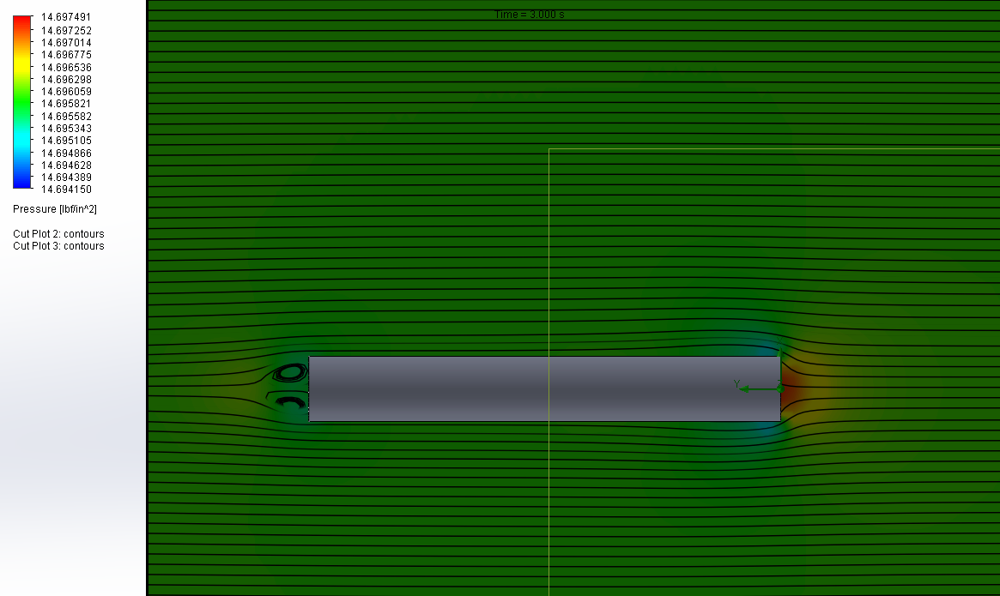<figcaption>Flow along the tube's length</figcaption></figure>
  <figure>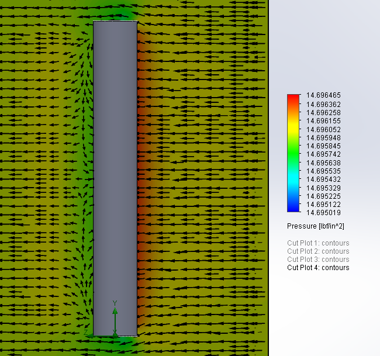<figcaption>Flow across the tube — much larger pressure region</figcaption></figure>

### Choosing the approach

We considered a moving lever arm, a buoyancy bladder, and thruster-driven pitching. A bladder was ruled out because sealing water inside a profiler — next to the batteries and electronics — is a well-known failure point. Our guiding requirements were **simplicity** (low cost, few single points of failure, easy for a non-engineer to maintain) and **functionality**. The lead-screw design was the best balance of the two.

### How it works

Two servo-driven lead screws slide blocks of syntactic buoyancy foam (yellow below) along the hull. Moving the foam away from the center of mass creates a moment arm, so the vehicle rotates until its center of mass sits directly under its center of buoyancy. In the vertical position the net torque is zero and the vehicle is naturally stable — if a current tips it, it rights itself.

  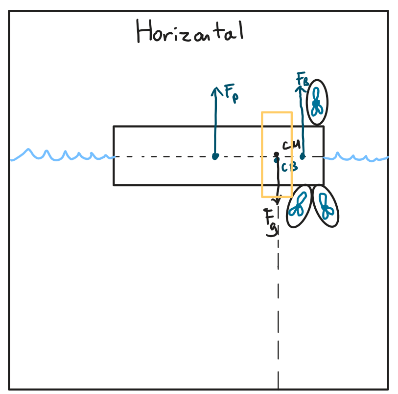
  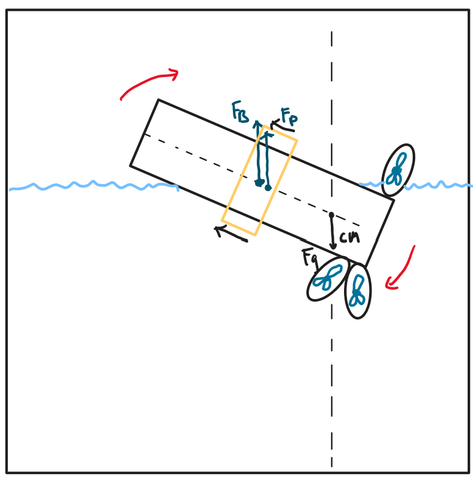
  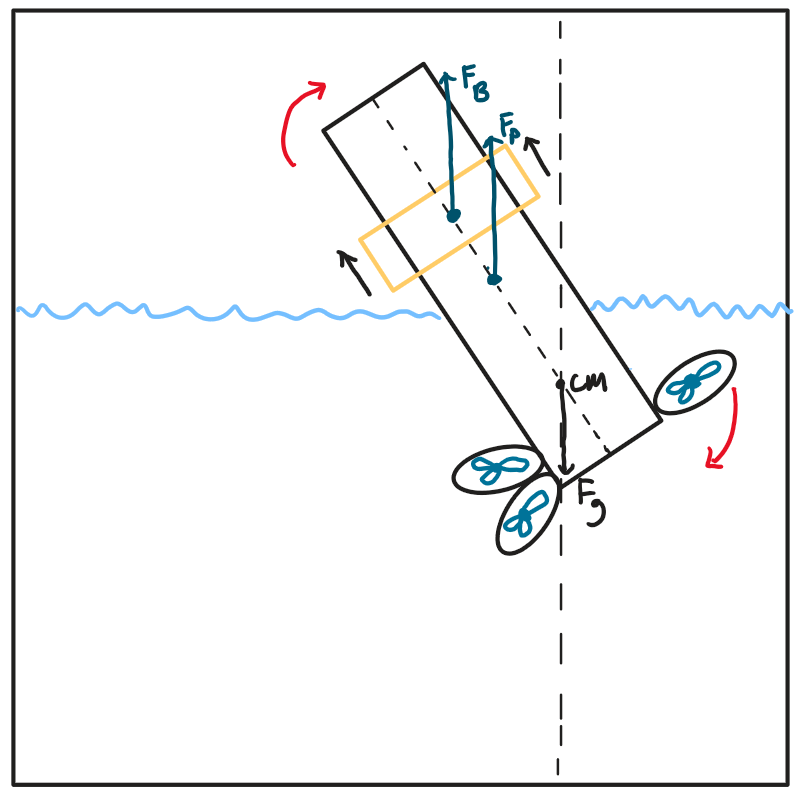
  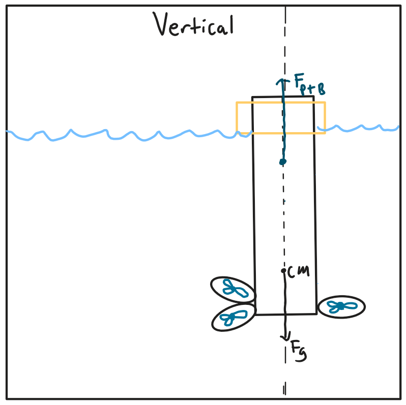

Free-body diagrams of the flip, from horizontal to vertical

### Sizing the actuators

There are very few actuators made for underwater use, so we were limited to the Blue Trail servos (Hitec HSR-M9382TH) the lab had tested, rated at **3.3 N·m**. I derived the foam volume needed to balance the vehicle from a torque balance in the horizontal position, then used power-screw equations to find the torque needed to move it:

T_push = (F·dₚ/2)·[(f·π·dₚ + P·cos α) / (π·dₚ·cos α − f·P)] + T_collar

- Moving the foam needs **under 1 N·m**.
- Even in the worst case — displacing the buoyant force of the entire profiler — it needs about **1.6 N·m**, a **safety factor of ~2** on the stock servo. That meant **no custom gearbox was needed**.
- I also checked the lowering torque to make sure the foam won't drift once positioned. It's positive, so the lead screw is **self-locking** and won't backdrive under load.

I wrote these calculations as a MATLAB script so the team could re-run them as the design changed.

### Build and testing

I started with center-of-gravity tests on a scaled tube to find the ballast weight and foam volume needed, then moved to the full prototype after months of assembly and CAD-to-hardware integration work.

  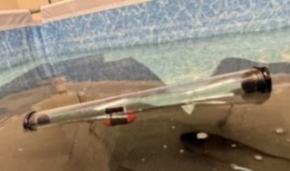
  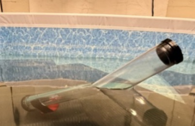
  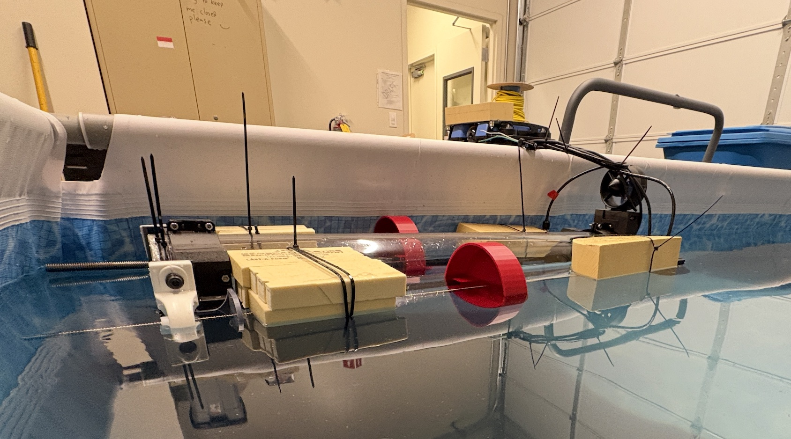

Early center-of-gravity and weight-distribution tests

In the pool test, the servos drove the foam forward for 175 s, paused 10 s, then reversed for 175 s. The vehicle **started horizontal, pitched smoothly toward vertical, and returned to horizontal** when the foam came back — proving the concept. The pool was too shallow for a full vertical hold (the nose touched the floor), so full validation needs deeper water.

  <figure>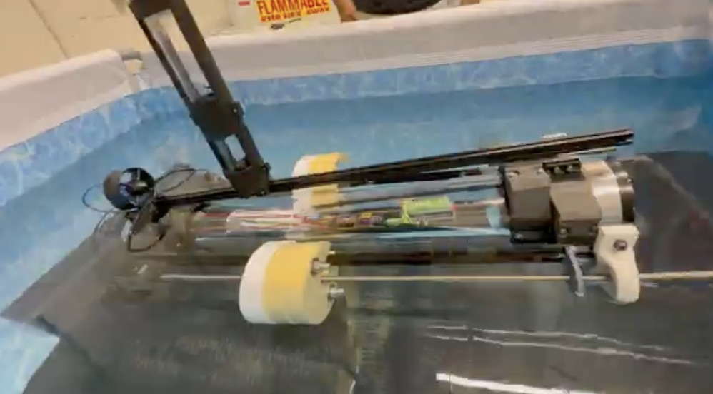<figcaption>Horizontal</figcaption></figure>
  <figure>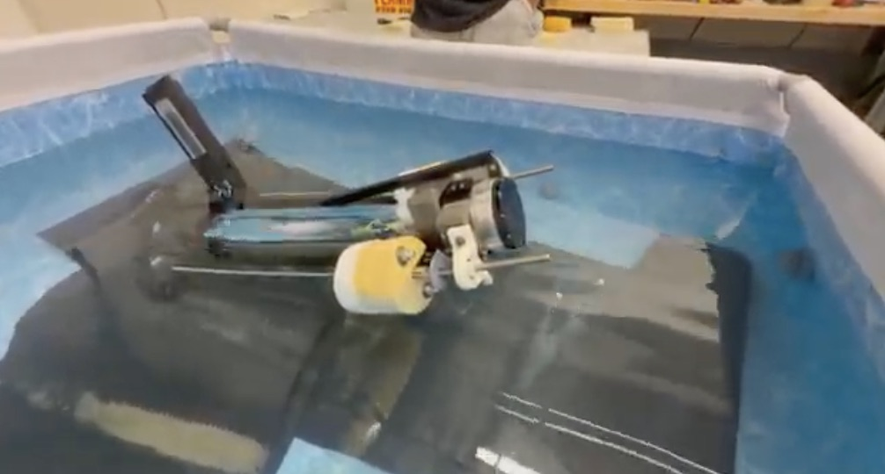<figcaption>Pitching toward vertical</figcaption></figure>
  <figure>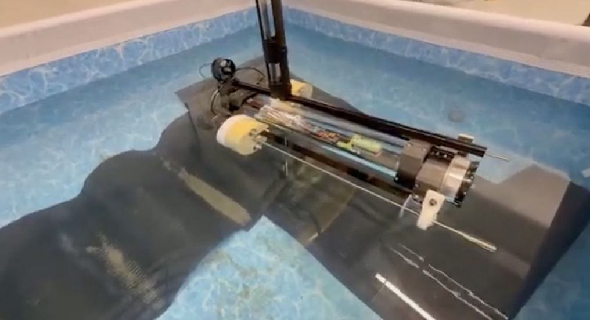<figcaption>Returned to horizontal</figcaption></figure>

<figure class="video">
  <video controls playsinline preload="none" poster="/assets/video/MANTARAY/leadscrew-dock-test.jpg">
    <source src="/assets/video/MANTARAY/leadscrew-dock-test.mp4" type="video/mp4">
  </video>
  <figcaption>Dockside test of the lead-screw assembly: the servos drive the buoyancy foam along the screws, commanded from a laptop</figcaption>
</figure>

---

## 2. Navigation control system

On the surface, MANTARAY steers toward each waypoint using GPS, an IMU for heading, and two thrusters in a differential-drive setup (like a tank). I modeled the full guidance loop in Simulink as four connected subsystems:

<figure>
  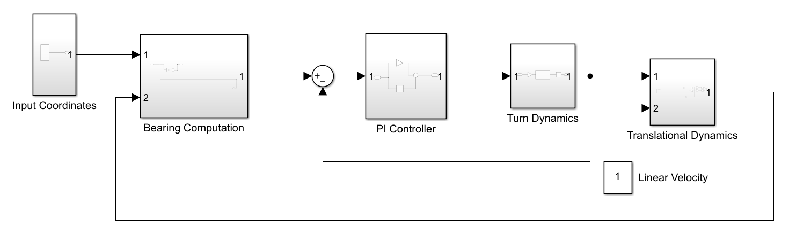
  <figcaption>Simulink model: bearing computation → PI controller → turn dynamics → translational dynamics, with position fed back</figcaption>
</figure>

**Bearing computation.** From the current GPS position and the target waypoint, the controller finds Δx and Δy and computes the desired heading with `atan2(Δy, Δx)`, which gives the full 360° without quadrant ambiguity.

**PI heading controller.** The heading error (desired bearing minus current heading) drives a PI controller that outputs a differential thrust command. The proportional term does most of the correcting; the integral term removes steady-state error caused by currents. I left out the derivative term because water's damping already suppresses oscillation. A ±5 m waypoint acceptance radius was enough for the mission.

**Turning dynamics.** The controller's torque command becomes a thrust difference between the two thrusters (τ = ΔF·d). I linearized the manufacturer's thrust curve to F = m·PWM so the controller can convert force directly to PWM commands for the ESCs. The vehicle's yaw response is modeled as τ = J·θ″ + b·θ′.

**Translational dynamics.** Integrating heading and forward speed (ẋ = v·cos θ, ẏ = v·sin θ) gives the vehicle's position, which feeds back to close the navigation loop.

The navigation algorithms were verified on their own; integrating them into the physical vehicle for in-water closed-loop trials is the next step.

<figure class="video">
  <video controls playsinline preload="none" poster="/assets/img/projects/MANTARAY/navigationprofiler.png">
    <source src="/assets/video/MANTARAY/navigation-simulation.mp4" type="video/mp4">
  </video>
  <figcaption>A simulated demonstration of the profiler moving using the control logic planned out</figcaption>
</figure>

---

## 3. Full-vehicle CAD

I designed the chassis and shifting mechanism in SolidWorks and managed the full vehicle assembly, integrating every subsystem into one model: the acrylic hull and end caps, the three thrusters, the T-slot rails and lead screws that carry the buoyancy foam, the internal electronics, and the antenna mast. Keeping one master assembly let the team check fit, clearances, and center of gravity before anything was built.

<figure>
  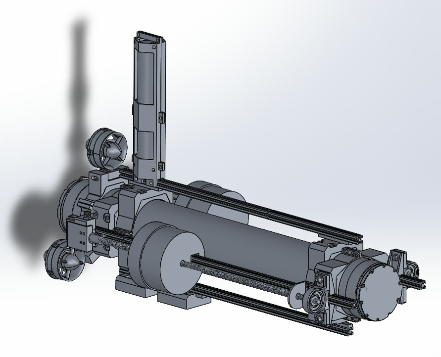
  <figcaption>Full assembly: hull, lead-screw foam sliders, thrusters, and antenna mast</figcaption>
</figure>

  <figure>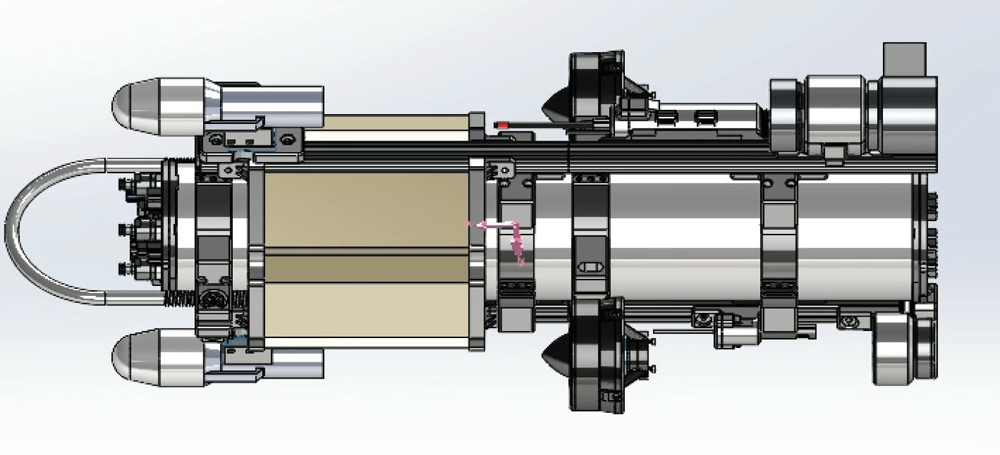<figcaption>Side view</figcaption></figure>
  <figure>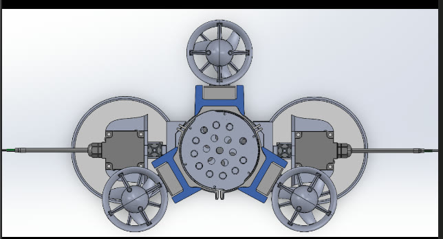<figcaption>End view: three thrusters and the two foam blocks</figcaption></figure>

  <figure>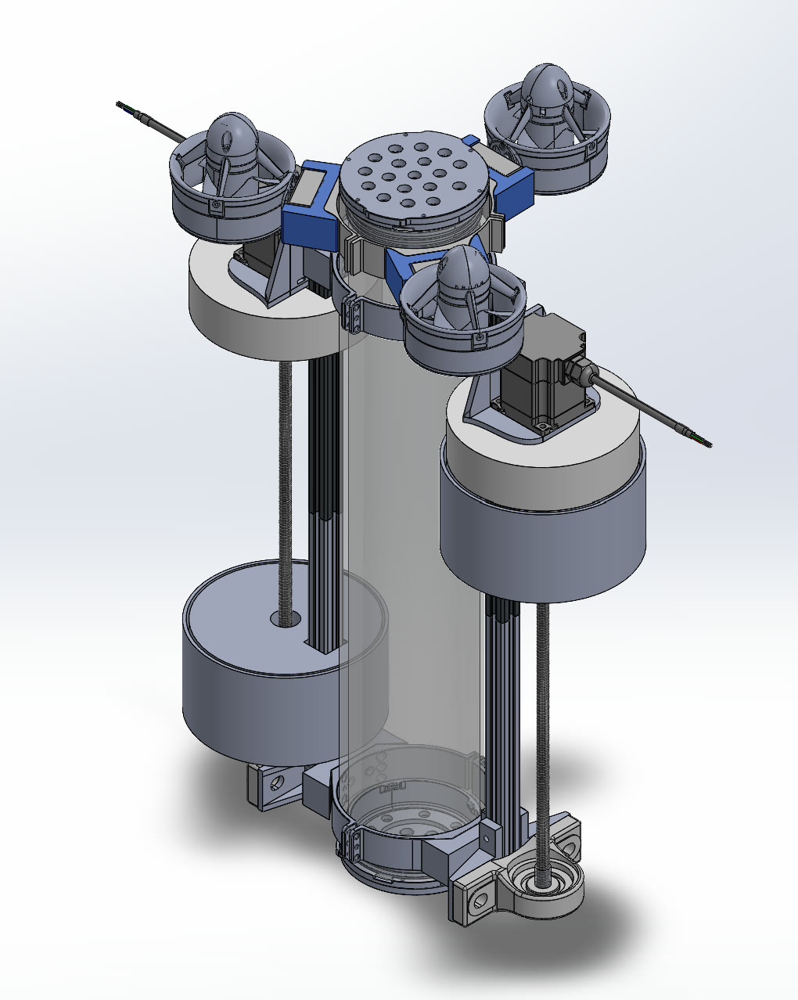<figcaption>Vertical orientation: three thrusters on top, foam blocks riding the lead screws</figcaption></figure>
  <figure>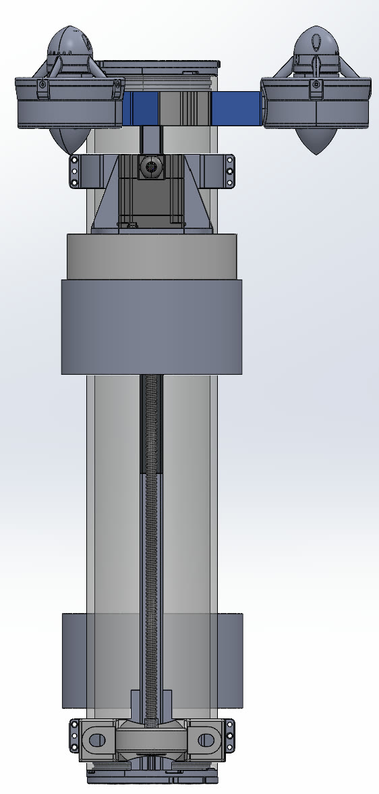<figcaption>Front view: lead screw running the length of the hull</figcaption></figure>

  <figure>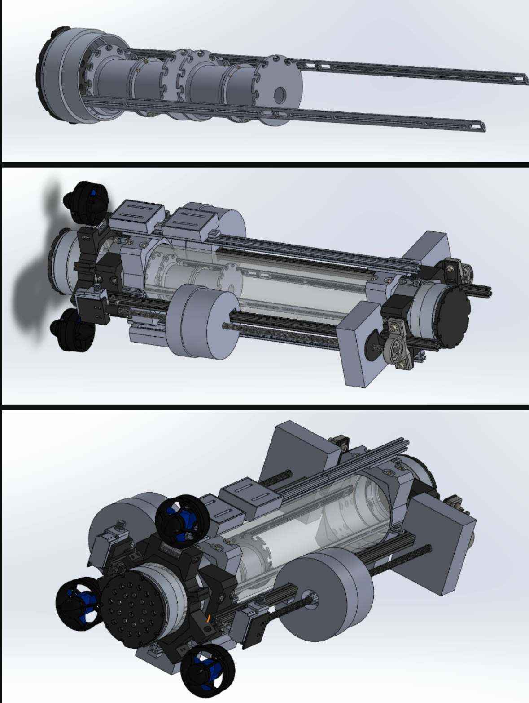<figcaption>Design progression</figcaption></figure>
  <figure>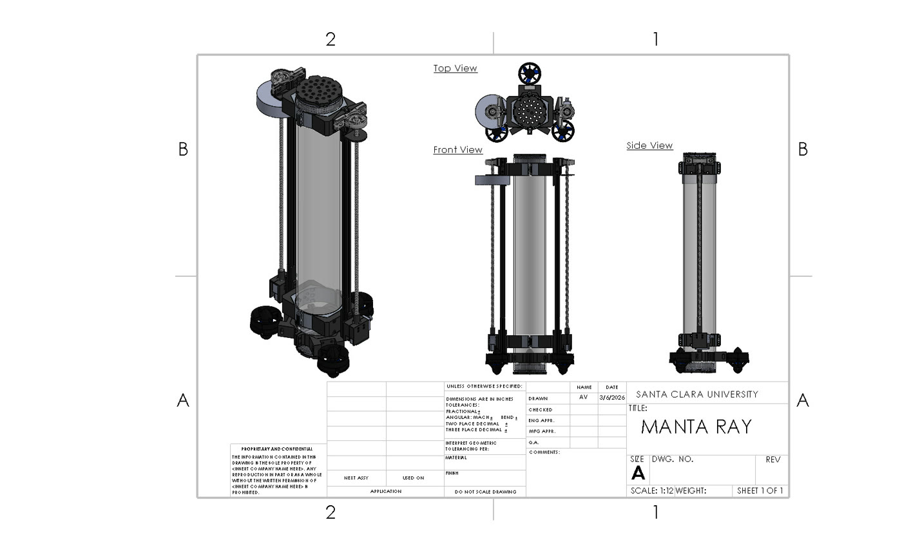<figcaption>Assembly drawing</figcaption></figure>

---

## 4. Power budget

To make sure MANTARAY could finish a mission on one charge, I built a power budget in Excel that walks through a mission phase by phase and tracks which components are on in each phase.

### Mission profile (per waypoint)

<table>
  <thead>
    <tr><th>Phase</th><th class="num">Time</th><th>Thrusters (3)</th><th>Servos (2)</th><th>Arduino, GPS, IMU</th><th>Science sensors</th></tr>
  </thead>
  <tbody>
    <tr><td>Transit on surface (100 m at 1 m/s)</td><td class="num">100 s</td><td class="on">ON</td><td class="off">off</td><td class="on">ON</td><td class="on">ON</td></tr>
    <tr><td>Flip to vertical</td><td class="num">120 s</td><td class="off">off</td><td class="on">ON</td><td class="on">ON</td><td class="off">off</td></tr>
    <tr><td>Dive (30 m at 0.25 m/s)</td><td class="num">120 s</td><td class="on">ON</td><td class="off">off</td><td class="on">ON</td><td class="on">ON</td></tr>
    <tr><td>Rise (30 m at 1 m/s)</td><td class="num">30 s</td><td class="off">off</td><td class="off">off</td><td class="on">ON</td><td class="on">ON</td></tr>
    <tr><td>Flip to horizontal</td><td class="num">120 s</td><td class="off">off</td><td class="on">ON</td><td class="on">ON</td><td class="off">off</td></tr>
    <tr class="total"><td>Total per waypoint</td><td class="num">490 s</td><td colspan="4">Thrusters on 220 s · servos on 240 s</td></tr>
  </tbody>
</table>

### Two-battery system

The vehicle carries two identical 14.8 V, 15.6 Ah batteries (230.9 Wh each). The thrusters — by far the largest load — run on one, and the servos, Arduinos, and sensors run on the other. I sized both for a **3-waypoint mission with a 25% safety margin**.

<table>
  <thead><tr><th>Battery 1 — thrusters</th><th class="num">Value</th></tr></thead>
  <tbody>
    <tr><td>Max current (3 thrusters × 22 A)</td><td class="num">66 A</td></tr>
    <tr><td>Assumed average current (50% of max)</td><td class="num">33 A</td></tr>
    <tr><td>Energy per waypoint (220 s of thrust)</td><td class="num">29.9 Wh</td></tr>
    <tr><td>Energy for 3 waypoints</td><td class="num">89.5 Wh</td></tr>
    <tr class="total"><td>With 25% margin</td><td class="num">111.9 Wh</td></tr>
  </tbody>
</table>

  
Battery 1 used48% (119 Wh left)

  

<table>
  <thead><tr><th>Battery 2 — electronics</th><th class="num">Value</th></tr></thead>
  <tbody>
    <tr><td>Servos (2×)</td><td class="num">9.99 Wh</td></tr>
    <tr><td>Arduinos (2×)</td><td class="num">0.06 Wh</td></tr>
    <tr><td>Science sensors (pH, temperature, conductivity, DO, pressure)</td><td class="num">0.23 Wh</td></tr>
    <tr class="total"><td>Total for 3 waypoints, with 25% margin</td><td class="num">10.28 Wh</td></tr>
  </tbody>
</table>

  
Battery 2 used4.5% (220.6 Wh left)

  

**Takeaway:** even with a 25% margin, a 3-waypoint mission uses under half of the thruster battery and under 5% of the electronics battery. The thrusters dominate energy use, so surface transit distance and dive speed are the main levers on range.

---

## Results

- **Flipping mechanism proven** in pool testing — the core concept of the vehicle works.
- **Actuators sized with a ~2× safety factor**, avoiding a custom gearbox, with a self-locking lead screw.
- **Navigation architecture modeled and verified** in Simulink.
- **Full vehicle integrated in one SolidWorks assembly**, from hull to antenna mast.
- **Power budget confirms a 3-waypoint mission** uses under half the thruster battery, with a 25% margin.

## What I'd improve next

- Rebuild around a standard 4 in. tube with Blue Robotics connectors to avoid custom-machined end-cap fixtures and improve sealing.
- Add Hall-effect or reed-switch limit sensors so the two lead screws stay in sync, instead of relying on timed servo commands.
- Run full in-water navigation trials and measure thrust to refine the yaw model.
- Upgrade to two-way telemetry (e.g. LoRa) so operators can see the vehicle's state in real time.
