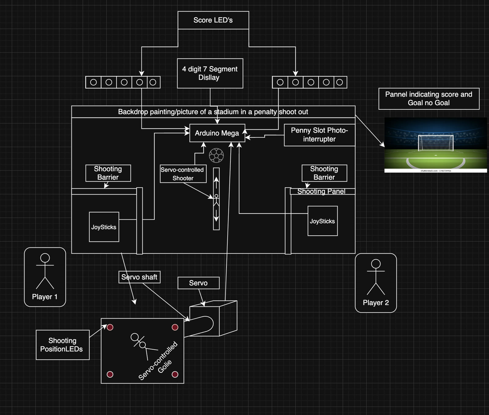
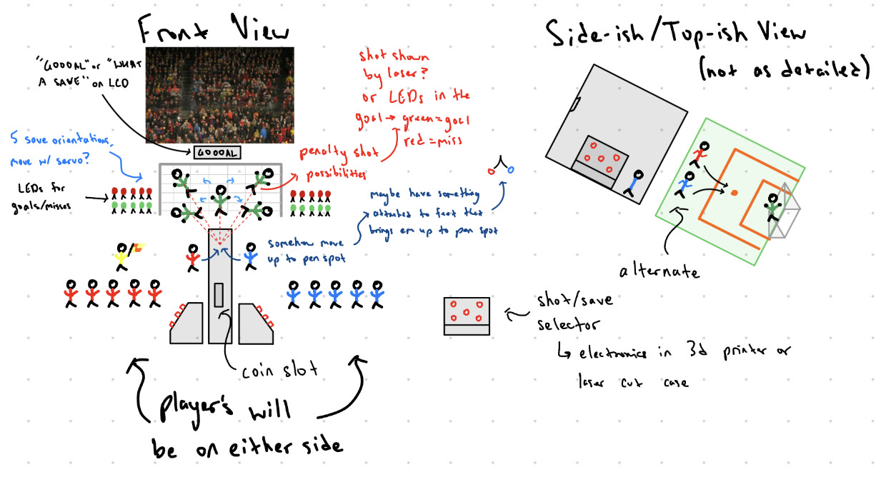
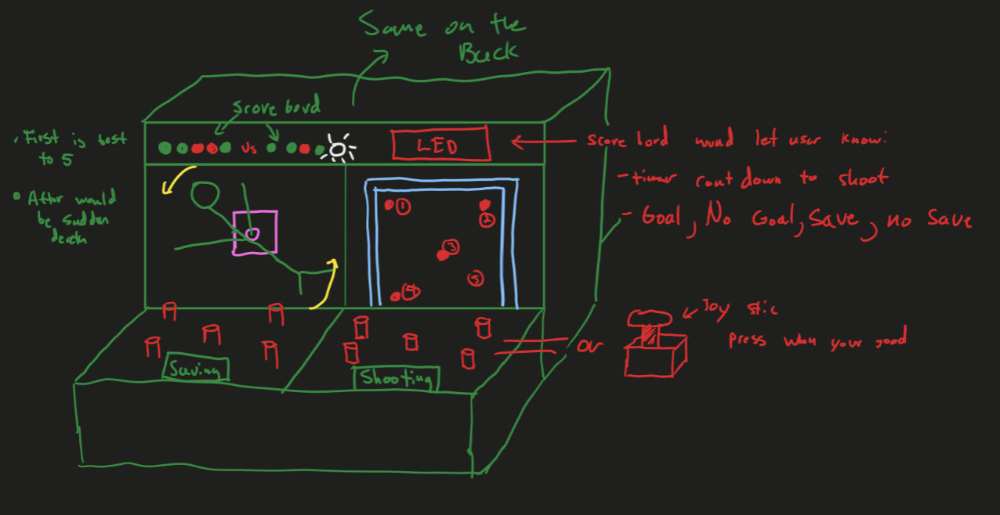
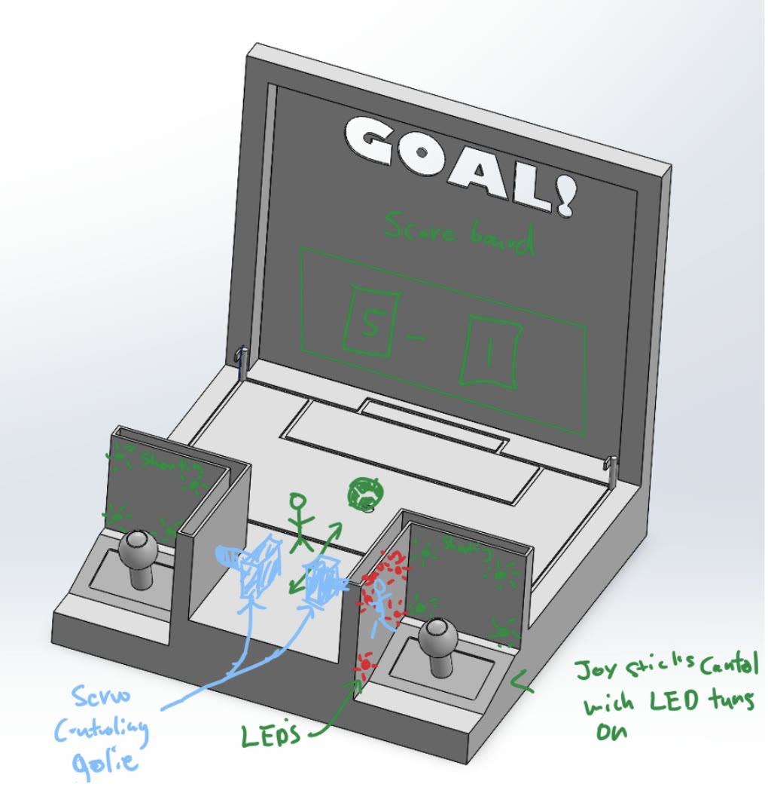
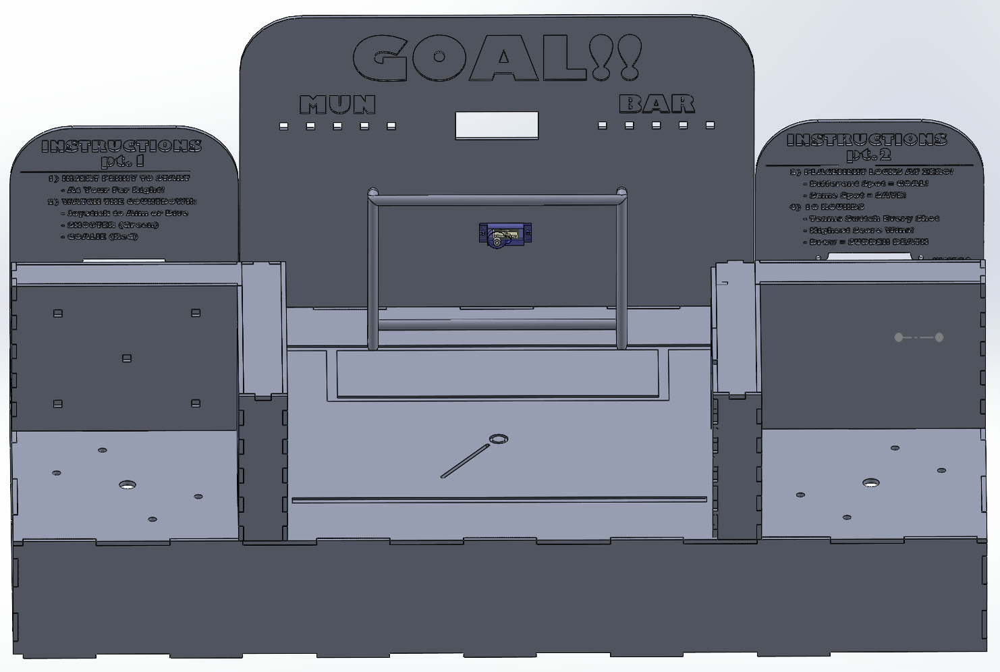
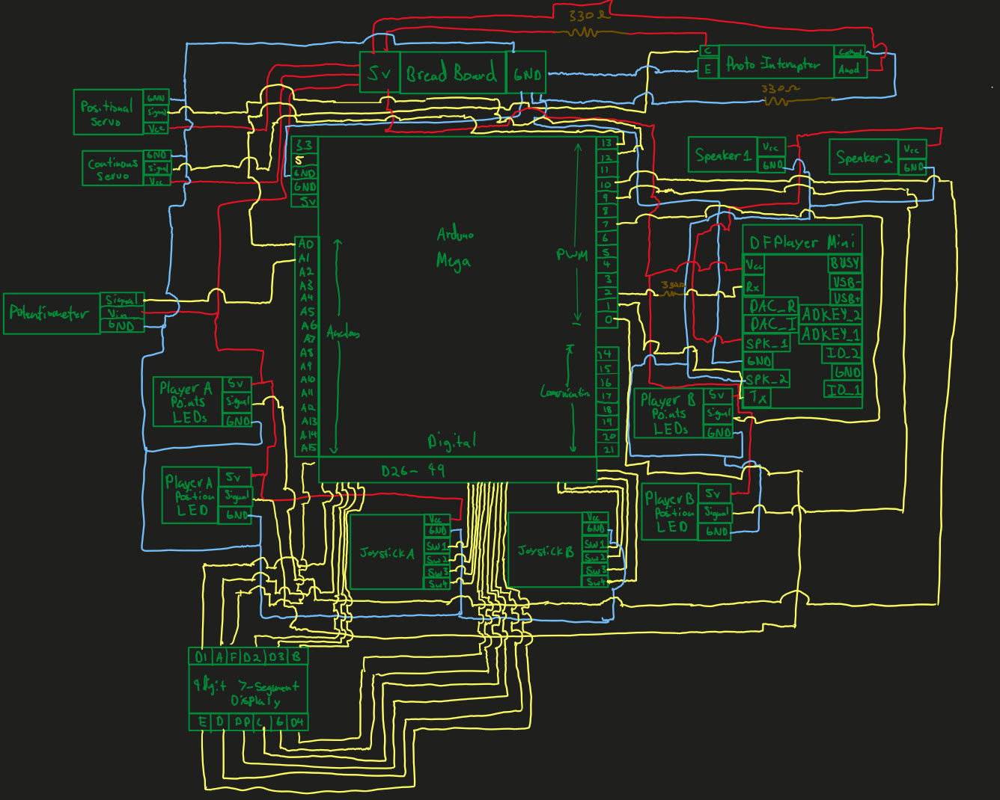

## Overview

GOAL!! turns the drama of a soccer penalty shootout into a tabletop arcade game. One player shoots, the other guesses where to dive, and the roles swap every round — first to out-score the other after five shots each wins, with sudden death if they're tied.

<div class="callout" markdown="1">
**Team:** Ysidro Magana and Elias Pedroza · **Instructor:** Dr. Kitts

**My role:**
- Designed the enclosure in SolidWorks, and soldered and crimped the wiring for the 2 actuators, 2 sensors, and 5 mechanical hardware interfaces.
- Tested, validated, and assembled the C++ Arduino game logic, sensor integration, and sound feedback.
</div>

<figure class="video">
  <video controls playsinline preload="none" poster="/assets/video/penalty-shootout/gameplay.jpg">
    <source src="/assets/video/penalty-shootout/gameplay.mp4" type="video/mp4">
  </video>
  <figcaption>Full game, from inserting the penny to the winner's song</figcaption>
</figure>

---

## 1. How the game works

In a real penalty shootout, each team takes five alternating shots one-on-one against the goalkeeper; the most goals wins, and a tie goes to sudden death. Here's how we built that into the game:

**1. Insert a penny.** With the game powered on, everything waits until a penny passes through a photo-interrupter. That triggers the Champions League anthem and a 17-second countdown on the display while the game gets ready.

**2. Pick your spot.** A whistle blows and a 10-second timer starts. The shooter picks a target — top left, top right, bottom left, bottom right, or middle — while the goalie tries to guess it, both using arcade joysticks. LEDs next to each joystick light up to show where each player is aiming. With 5 seconds left, the penalty-taker figure starts running up to the ball, driven by a continuous-rotation servo.

**3. Reveal.** When time runs out, the two choices are compared. If the goalie guessed wrong, the display reads **GOAL**, a cheer plays, and the shooter's next score LED turns green. If the goalie guessed right, it reads **SAVE**, a buzzer plays, and the LED turns red. Either way, the goalie servo dives to the spot the goalie chose (5° bottom right, 45° top right, 90° middle, 135° top left, 175° bottom left).

**4. Switch sides.** The players swap roles and repeat for 10 rounds, so each shoots 5 times. The team names on the scoreboard are **MAN** (Manchester United) and **BAR** (Barcelona). The winner gets their club's song, and the display reads **END**.

**5. Sudden death.** If it's tied after 10 rounds, a "Final Round, Fight!" sound from Mortal Kombat plays and the game continues until one player scores while the other misses.

---

## 2. Components

<figure>
  
  <figcaption>Component diagram: how the hardware is laid out and connected to the Arduino Mega</figcaption>
</figure>

<div class="table-scroll">
<table>
  <thead><tr><th>Part</th><th>What it does</th></tr></thead>
  <tbody>
    <tr><td>ELEGOO Mega R3 (ATmega2560)</td><td>Runs all game logic</td></tr>
    <tr><td>2 × Sanwa JLF-TP-8YT arcade joysticks</td><td>Player aiming and diving</td></tr>
    <tr><td>WS2812B addressable LED strips</td><td>Live aiming feedback, score history, and goal-frame lights</td></tr>
    <tr><td>360° continuous-rotation servo</td><td>Penalty taker's run-up</td></tr>
    <tr><td>Tower Pro SG90 micro servo</td><td>Goalie dive</td></tr>
    <tr><td>4-digit 7-segment display</td><td>Countdown, GOAL / SAVE, and END</td></tr>
    <tr><td>Optical photo-interrupter</td><td>Detects the penny to start the game</td></tr>
    <tr><td>DFPlayer Mini MP3 module + 2 × 3 W speakers</td><td>Whistle, anthem, crowd, and winner songs</td></tr>
    <tr><td>Potentiometer</td><td>Volume knob</td></tr>
    <tr><td>5 V 3 A power supply</td><td>Powers everything</td></tr>
  </tbody>
</table>
</div>

---

## 3. Software

As mechanical engineering students, the code was one of the hardest parts. Getting each component working on its own was straightforward; getting them all to work together following the game logic took the most time. Many of the parts came with little documentation, so the continuous servo, joysticks, LED strips, audio, and 7-segment display each needed hardware and software calibration. It was also our first project combining mechanical, electrical, and software design into one product.

Each round runs in three phases — **countdown**, **reveal**, and **reset**. The reveal is the heart of the game:

```cpp
// --- PHASE 2: REVEAL ---
runner.write(RUN_STOP);

int goalieMove  = p1IsShooter ? p2Choice : p1Choice;
int shooterMove = p1IsShooter ? p1Choice : p2Choice;
moveGoalieServo(goalieMove);

bool isGoal = (shooterMove != goalieMove);
if (p1IsShooter && isGoal)  p1Score++;
if (!p1IsShooter && isGoal) p2Score++;
updateHistoryStrip(isGoal);
```

Each joystick's four switches are read and turned into one of five target zones:

```cpp
int getZone(int pUp, int pDn, int pLt, int pRt) {
  bool d = !digitalRead(pDn), l = !digitalRead(pLt), r = !digitalRead(pRt);
  if (d && l) return 3;   // bottom left
  if (d && r) return 2;   // bottom right
  if (l) return 0;        // top left
  if (r) return 1;        // top right
  return 4;               // middle
}
```

The game ends only after 10 rounds **and** when the score isn't tied, which is what makes sudden death work automatically. Inserting another penny after the game resets the Arduino for a new match.

---

## 4. Design: from sketches to CAD

We started with hand sketches of the layout — players on either side, the goal and scoreboard in the back, and a coin slot in the middle — then modeled a concept in SolidWorks before finalizing the enclosure.

<div class="img-row">
  <figure><figcaption>Early sketch: front and top views</figcaption></figure>
  <figure><figcaption>Early sketch: cabinet and scoreboard</figcaption></figure>
</div>

<div class="img-row">
  <figure><figcaption>Initial concept CAD</figcaption></figure>
  <figure><figcaption>Final CAD assembly</figcaption></figure>
</div>

---

## 5. Electrical schematic

Most components connect straight to the Arduino Mega, 5 V, or ground, so the wiring is direct — but with two joysticks, five LED strips, a multiplexed 7-segment display, two servos, and the audio module, there are a lot of connections to keep track of.

<figure>
  
  <figcaption>Final electrical schematic with every component's pin connections</figcaption>
</figure>

---

## What I learned

- **Integration is the hard part.** Each part worked alone quickly; making them run together in one game loop took most of the time.
- **Calibrate everything.** Budget parts with little documentation needed testing to find the right servo speeds, angles, and LED mappings.
- **Design for the player.** Live LED feedback, sound, and a physical penny slot made it feel like a real arcade game.
