## Overview

The thermal chamber is a box with a heater, a temperature sensor, an Arduino, and an LCD. I used it to implement one control strategy after another and see how each one behaves on real hardware: starting with simple on/off control built from logic gates, then moving to software controllers with increasing sophistication.

<div class="callout" markdown="1">
**Solo project** · **Instructor:** Dr. Kitts

The heater is driven by a PWM signal from the Arduino. Every controller samples the temperature every 0.5 s, shows it on the LCD, and streams it as CSV so I could plot each run.
</div>

---

## 1. Hardware state machine

The first controller keeps the chamber between two thresholds with **hysteresis**: the heater turns on below a low temperature and stays on until it passes a high temperature, then stays off until the chamber cools back down. This prevents the heater from rapidly switching on and off around a single setpoint.

I designed it the way digital logic is designed by hand: draw the **state machine**, turn it into a **truth table** (current state + temperature inputs → next state + heater output), solve for the **Boolean equation**, and build the **logic circuit** with a flip-flop holding the state.

<div class="img-row">
  <figure>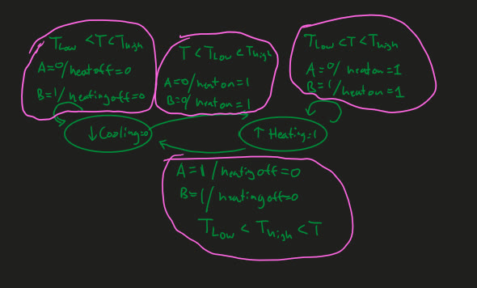<figcaption>State machine: heating and cooling states</figcaption></figure>
  <figure>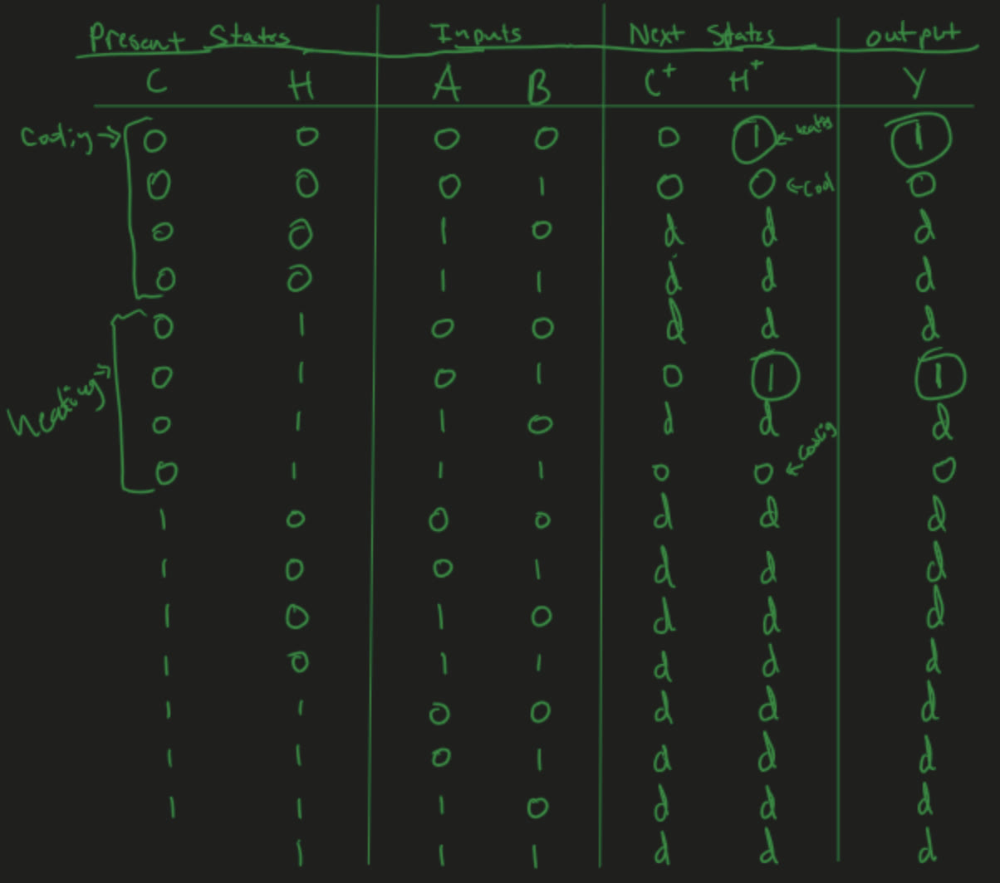<figcaption>Truth table</figcaption></figure>
  <figure>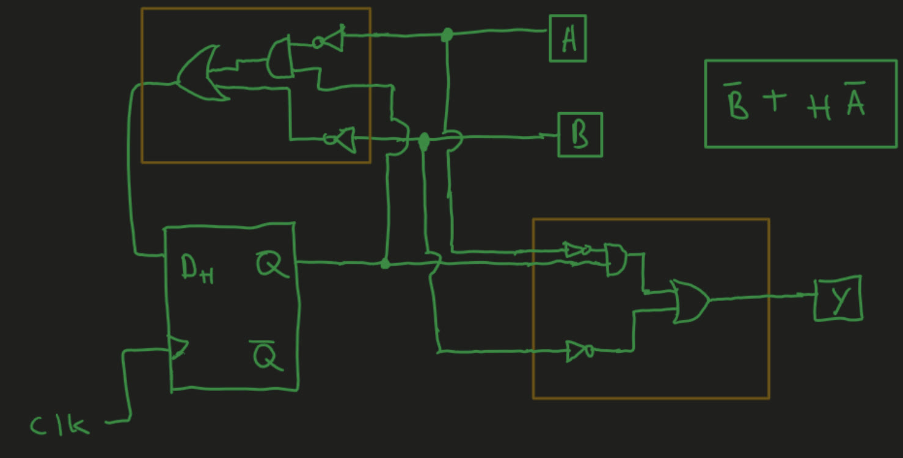<figcaption>Logic circuit</figcaption></figure>
</div>

I then built the same logic in Simulink to check the behavior: the temperature rises, then cycles between the two thresholds as the heater switches.

<div class="img-row">
  <figure>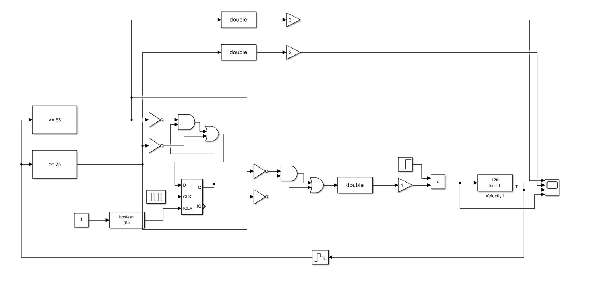<figcaption>Simulink model of the state machine</figcaption></figure>
  <figure>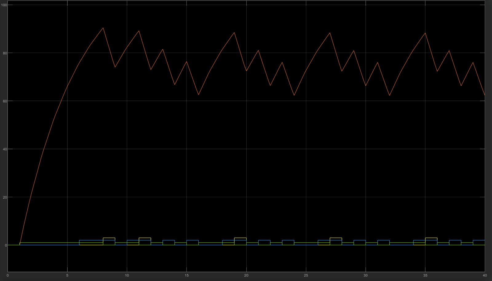<figcaption>Simulated temperature cycling between thresholds</figcaption></figure>
</div>

### The same logic in software

I also implemented the hysteresis in code, written as a single ternary expression. The thresholds can be changed live over serial (`LOW=##`, `HIGH=##`), and LEDs show whether the heater is on:

```cpp
heaterOn = (heaterOn && temperatureF < T_high)  ? true :
           (!heaterOn && temperatureF < T_low)  ? true :
           false;
digitalWrite(heaterPin, heaterOn ? HIGH : LOW);
```

---

## 2. Open-loop control

With no feedback, the controller drives the heater blindly and assumes the system behaves as expected. By testing, I found the PWM signal that held each target temperature and computed a gain from it:

<p class="formula">Gain = PWM / (T_final − T_ambient)</p>

| Target | PWM | Gain |
|---|---|---|
| 5 °F above ambient (76.1 °F) | ≈ 58 | 11.63 |
| 10 °F above ambient | 105 | 10.5 |
| 90 °F | 175 | 8.79 |

<figure>
  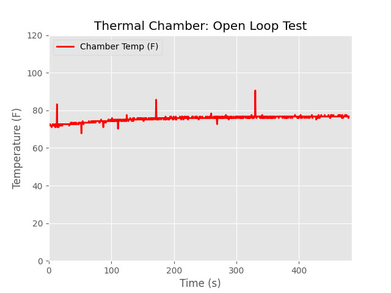
  <figcaption>Open-loop test targeting 76.1 °F</figcaption>
</figure>

Open loop can reach a target, but only after a lot of trial and error — and it can't correct for any disturbance.

---

## 3. Proportional control

Adding feedback, the heater's PWM is set by the error between the setpoint and the measured temperature (`PWM = Kp · error`). I swept the gain and ran each test for 7 minutes:

<div class="table-scroll">
<table>
  <thead><tr><th>Kp</th><th>Steady-state error</th></tr></thead>
  <tbody>
    <tr><td>15</td><td>≈ 5 °F</td></tr>
    <tr><td>25</td><td>≈ 4 °F</td></tr>
    <tr><td>35</td><td>≈ 3 °F</td></tr>
    <tr><td>65</td><td>≈ 1–2 °F, with slight overshoot</td></tr>
  </tbody>
</table>
</div>

<div class="img-row">
  <figure>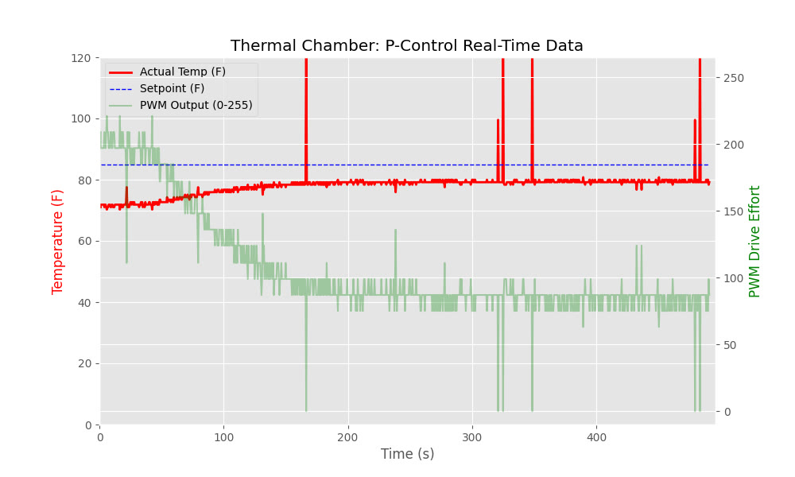<figcaption>Kp = 15</figcaption></figure>
  <figure>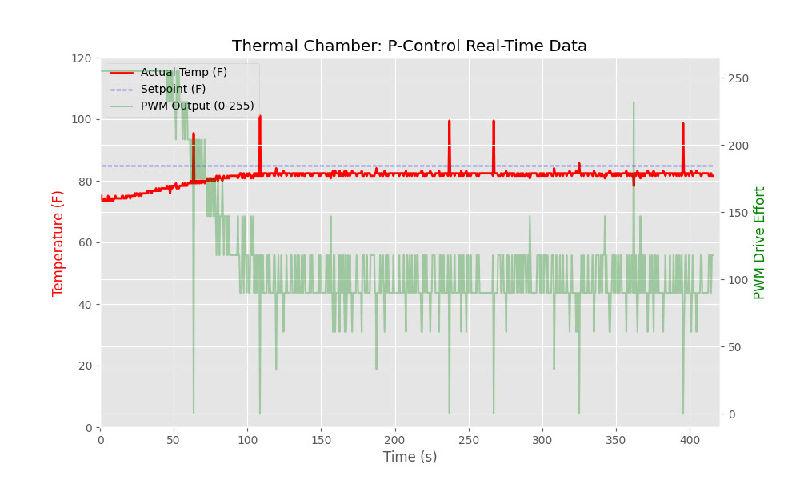<figcaption>Kp = 35</figcaption></figure>
</div>
<div class="img-row">
  <figure>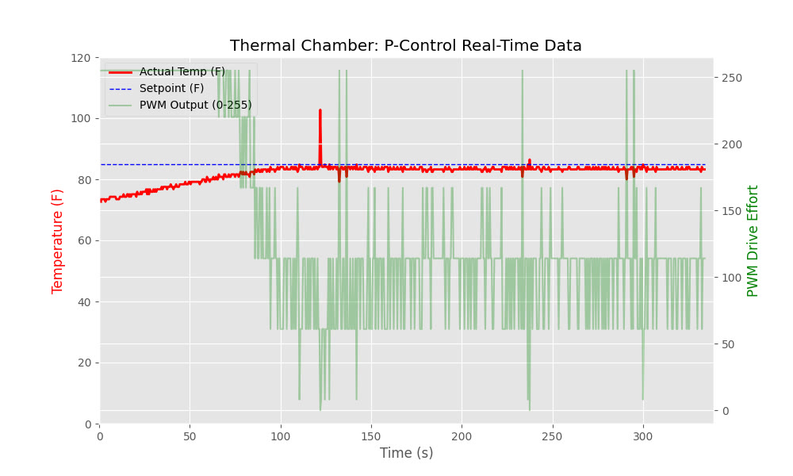<figcaption>Kp = 65</figcaption></figure>
  <figure>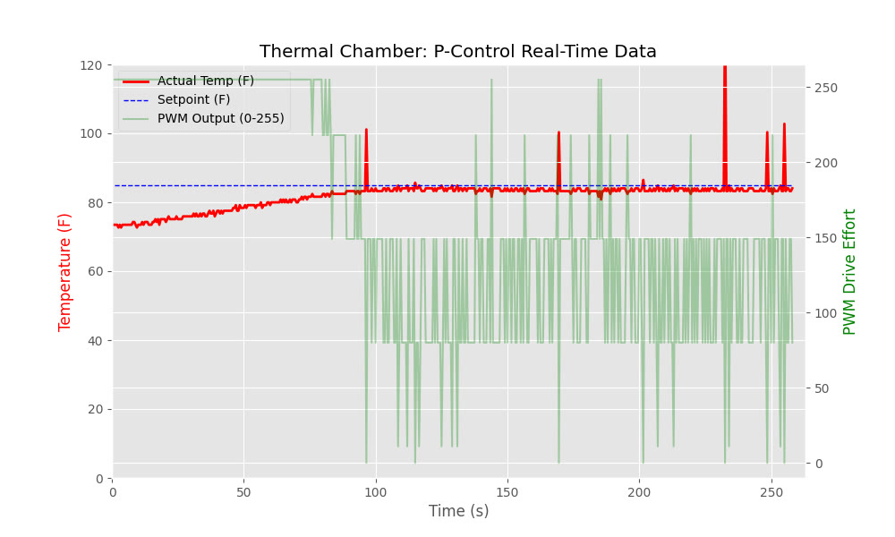<figcaption>Kp = 85</figcaption></figure>
</div>

The green PWM trace shows what's happening: as the temperature rises, the drive effort falls. At Kp = 15 it settles around 45 PWM — only enough to hold about 80 °F, so a steady-state error remains. Higher gains shrink that error. A Simulink model with the same gain predicted the same ~5 °F error:

<div class="img-row">
  <figure>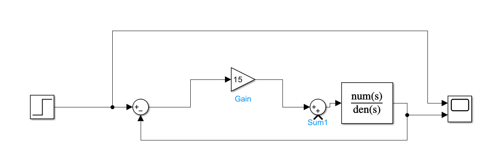<figcaption>Simulink model</figcaption></figure>
  <figure>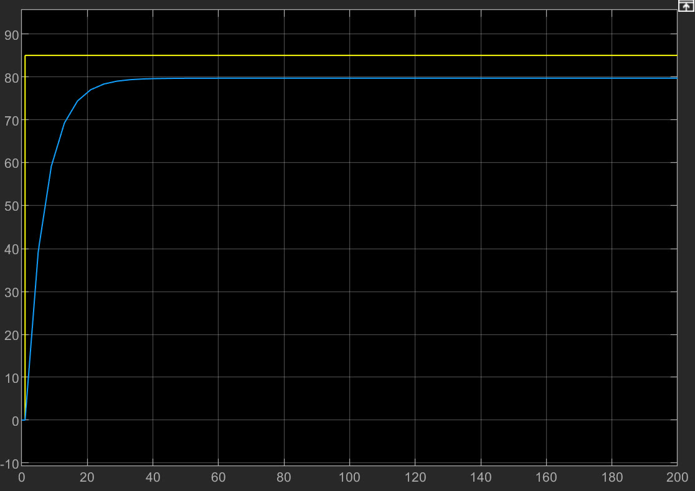<figcaption>Simulated Kp = 15: ≈ 5 °F steady-state error</figcaption></figure>
</div>

---

## 4. Proportional + feedforward

The open-loop tests gave an average gain of 10.31. I used 80% of it, **Kff = 8.25**, as a feedforward term that predicts the power needed to hold the setpoint above ambient, and added proportional feedback on top:

```cpp
float p_effort  = Kp * error;                       // reactive
float ff_effort = Kff * (setpointF - ambientF);     // predictive
float totalEffort = p_effort + ff_effort;
```

<div class="img-row">
  <figure>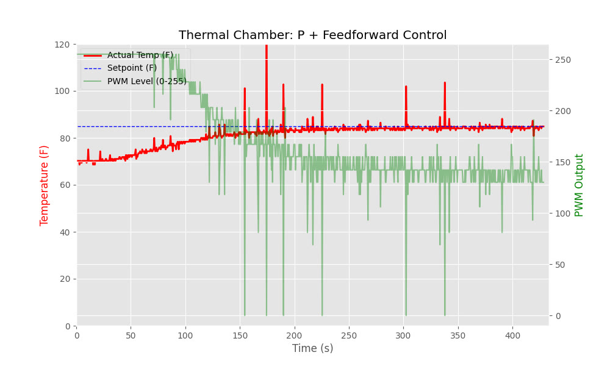<figcaption>Feedforward + Kp = 15</figcaption></figure>
  <figure>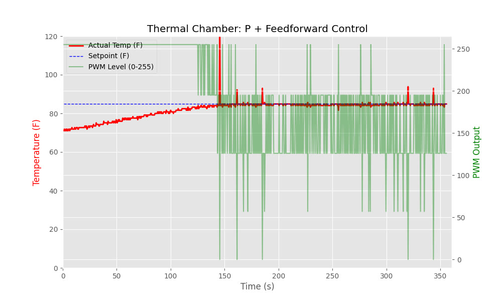<figcaption>Feedforward + Kp = 85</figcaption></figure>
</div>

Compared with pure proportional control at the same gain, the steady-state error was eventually eliminated: the feedforward term supplies the baseline power the proportional term alone couldn't. With Kp = 85, the temperature settled very close to the 85 °F setpoint.

---

## 5. PI control and integral windup

Adding an integral term turns the response from first-order to second-order, which shows up as overshoot — most clearly in the PWM signal oscillating after the setpoint is reached. The underdamped response was small in practice and matched the Simulink model.

<figure>
  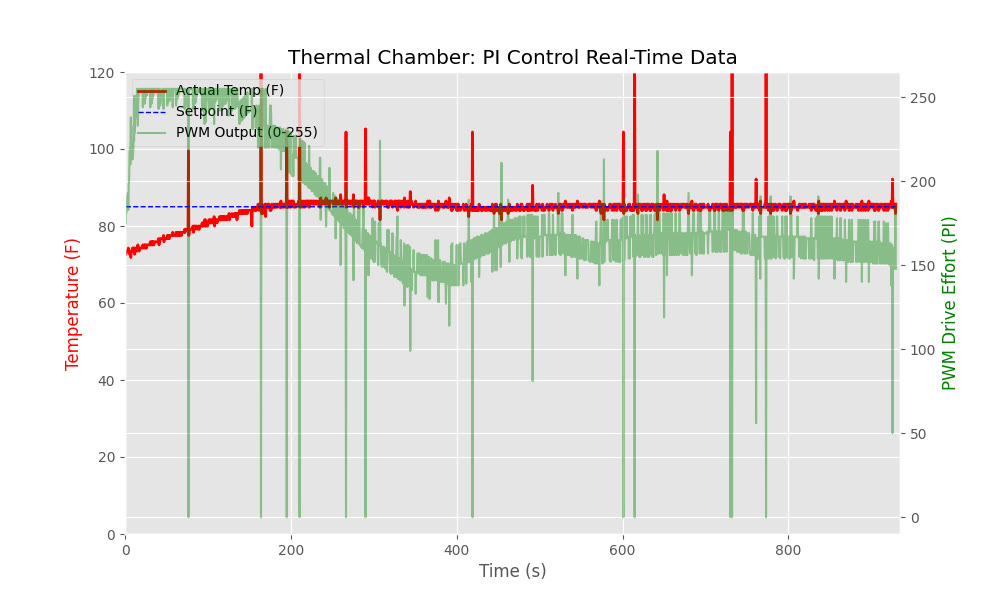
  <figcaption>PI control on hardware</figcaption>
</figure>

<div class="img-row">
  <figure>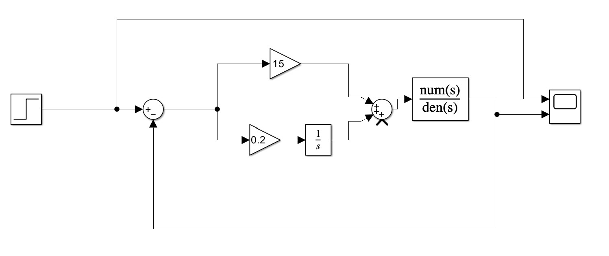<figcaption>Simulink PI model</figcaption></figure>
  <figure>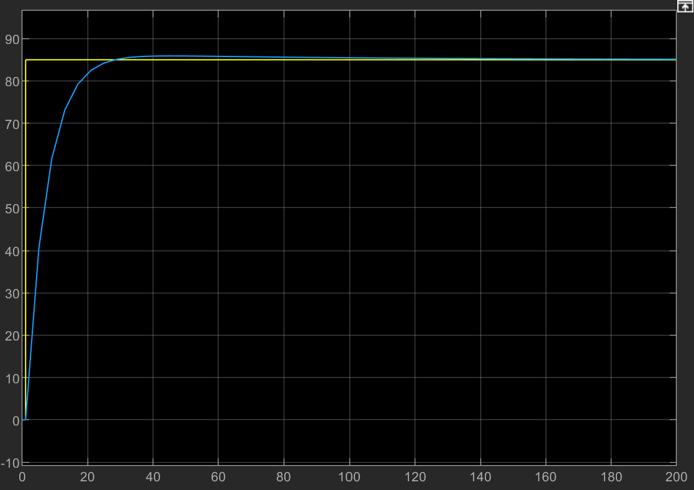<figcaption>Simulated PI response</figcaption></figure>
</div>

**Integral windup.** I also demonstrated windup on purpose: I set the target to 110 °F, above what the heater can reach, so the integral sum kept growing. When I lowered the setpoint to 85 °F, the integral took about **5 minutes** to unwind to zero before the controller let the chamber cool.

<figure>
  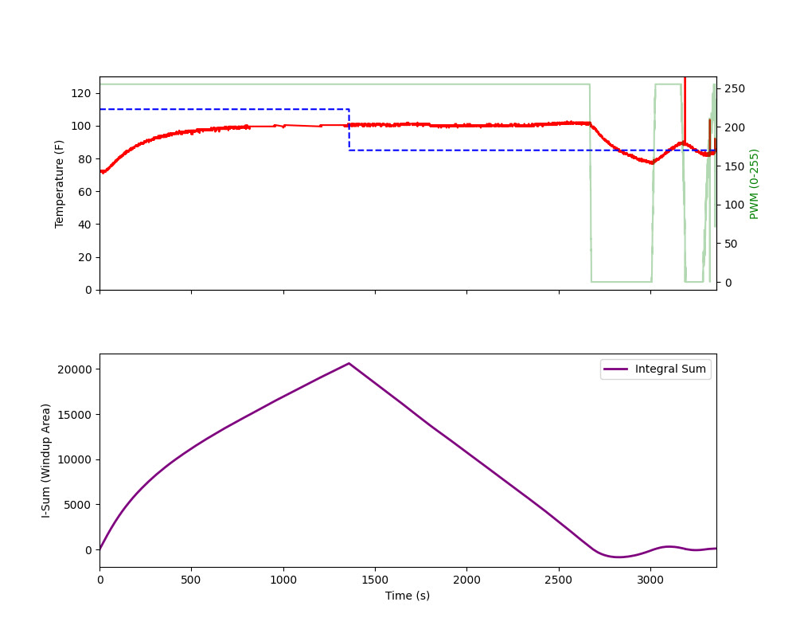
  <figcaption>Integral windup: the integral sum (bottom) keeps growing while the setpoint is unreachable, then slowly unwinds</figcaption>
</figure>

---

## 6. PID control

Finally, I implemented full PID with **Kp = 30, Ki = 0.2, Kd = 15** and logged each term's contribution separately.

<figure>
  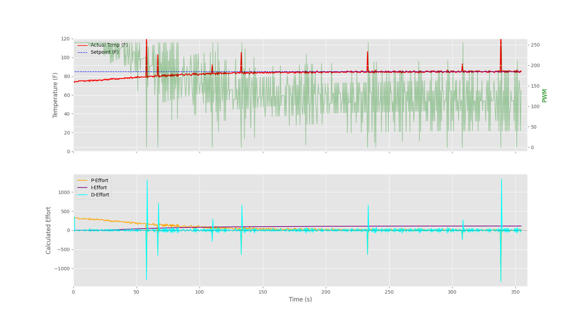
  <figcaption>PID control on hardware (top) and each term's contribution (bottom)</figcaption>
</figure>

The proportional term does most of the work driving the temperature up. As the temperature nears the setpoint, the integral term takes over and pulls out the remaining steady-state error. Because a thermal system responds slowly, the derivative term contributes very little — something the Simulink model also showed.

<div class="img-row">
  <figure>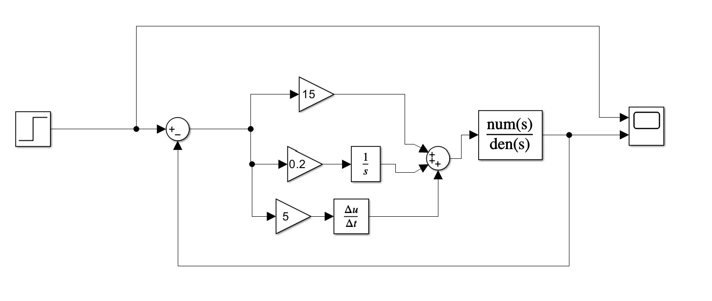<figcaption>Simulink PID model</figcaption></figure>
  <figure>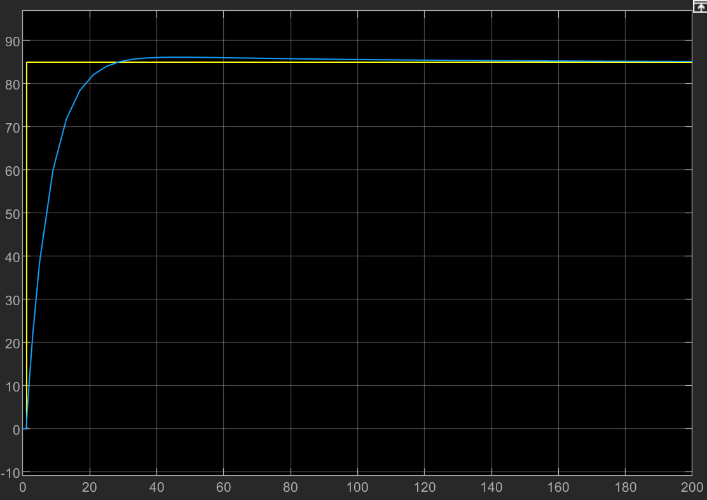<figcaption>Simulated PID response</figcaption></figure>
</div>

---

## What I learned

- **Each term has a job.** P reacts to error, feedforward supplies the baseline effort, I removes steady-state error, and D matters little for a slow thermal system.
- **Proportional control alone leaves error.** Raising the gain shrinks it but doesn't eliminate it; feedforward or integral action does.
- **Windup is real.** An unreachable setpoint can leave the integral term "stuck" for minutes — a good reason for anti-windup limits, which I used later on my [PID seesaw](/projects/pid-seesaw/).
- **Simulation and hardware agree for simple systems.** The Simulink models predicted the hardware's steady-state error and response shape well.
