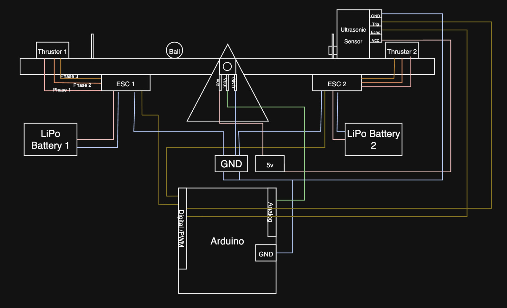
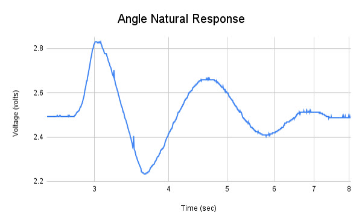
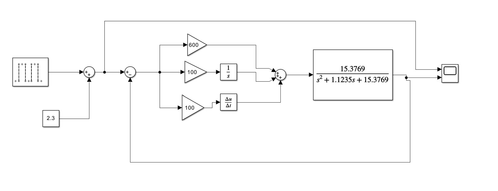
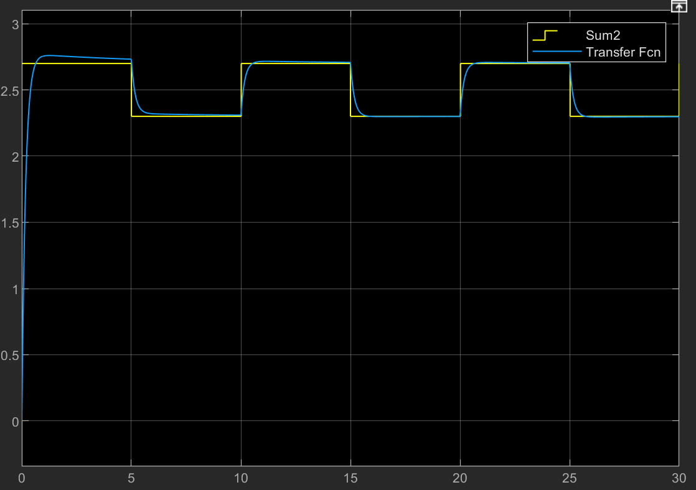
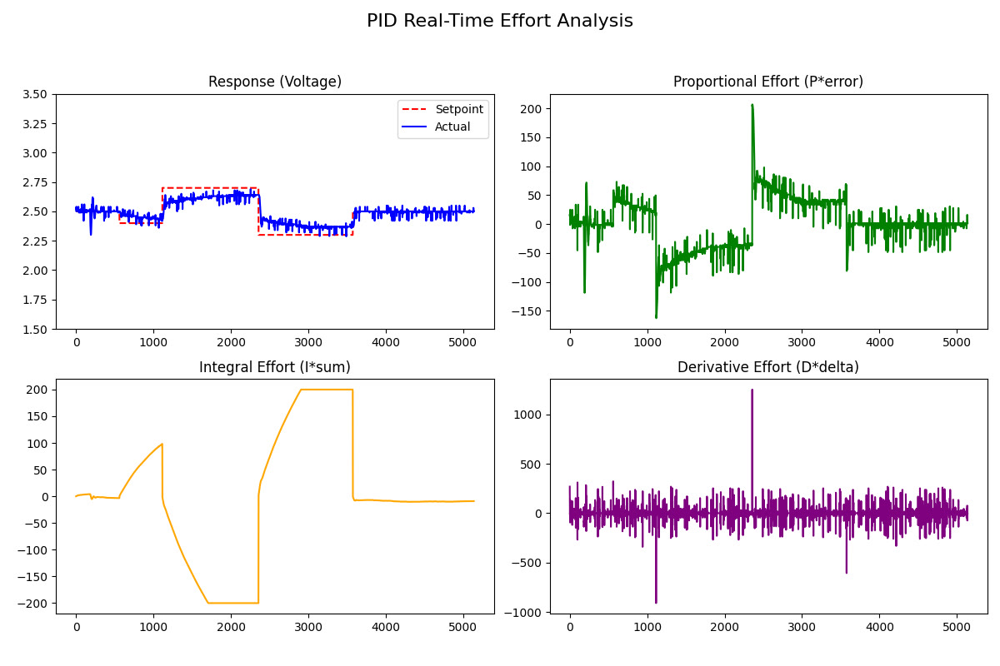
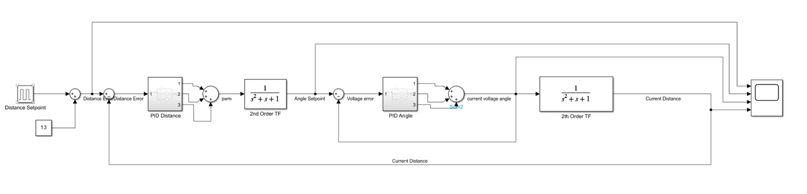
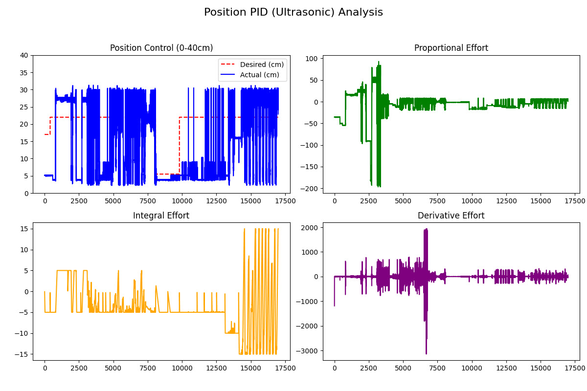

## Overview

I built a balancing seesaw as a dual-feedback control system with two goals: **control the angle of the beam**, then **control the position of a ball rolling on it**. The beam is tilted by a thrust differential between two brushless motors mounted on opposite ends, driven by PWM signals to their ESCs from a PID controller on an Arduino.

<div class="callout" markdown="1">
**Solo project** · **Instructor:** Dr. Kitts

- **Angle control:** achieved — the beam tracks commanded angles reliably.
- **Position control:** came close — the ball held the setpoint briefly, and I traced the remaining problem to sensor noise from the beam's geometry.
</div>

<figure class="video">
  <video controls playsinline preload="none" poster="/assets/video/pid-seesaw/angle-control.jpg">
    <source src="/assets/video/pid-seesaw/angle-control.mp4" type="video/mp4">
  </video>
  <figcaption>Angle control in action: the beam follows setpoint changes sent from the laptop</figcaption>
</figure>

---

## 1. System design

<figure>
  
  <figcaption>Component diagram: two thrusters and ESCs, LiPo batteries, the pivot potentiometer, the ultrasonic sensor, and the Arduino</figcaption>
</figure>

I first built the seesaw as an unstable system, then added weight below the axis of rotation to make it **inherently stable** — a mechanical change that made the control problem much more manageable.

**Angle sensing.** I started with a rotary encoder, but its readings were too coarse and drifted. I switched to a **10k potentiometer** fixed to the pivot: with a 5 V reference across it, its output voltage changes linearly with beam angle. A 5 V regulator kept the reference steady, and an **op-amp buffer** between the potentiometer and the Arduino eliminated the noise that had been scattering the readings. With some 3D-printed attachments, this setup was very reliable.

**Position sensing.** An **HC-SR04 ultrasonic sensor** at one end measures the ball's distance by timing an echo and converting it with the speed of sound (0.0343 cm/µs).

**Actuation.** Two **D2836 outrunner brushless motors** provided plenty of thrust, but they were harder to control than expected — even with ESCs, they need careful timing and power delivery. In hindsight, brushed motors, whose thrust tracks voltage directly, would have been easier.

---

## 2. Modeling the angle dynamics

The beam's angle is a **second-order system**: differential thrust creates a torque, torque sets angular acceleration, and two integrations give the angle. To build an accurate model, I ran an **impulse response test** — I let the beam settle, nudged it, and recorded the oscillations as it returned to equilibrium.

<figure>
  
  <figcaption>Natural response after a nudge, measured as potentiometer voltage</figcaption>
</figure>

From this response I used the **logarithmic decrement** to find the damping ratio, then the damped period to find the natural frequency:

<p class="formula">(1/n)·ln(y₁/y₂) = 2πζ / √(1 − ζ²)   →   ζ = 0.143</p>
<p class="formula">f_d = 1/T_d,   f_n = f_d / √(1 − ζ²),   ω_n = 2π·f_n   →   ω_n = 3.92 rad/s</p>

Plugging these into the standard second-order form gave the plant's transfer function, which I used in a Simulink model of the PID loop:

<p class="formula">G(s) = ω_n² / (s² + 2ζω_n·s + ω_n²) = 15.38 / (s² + 1.12s + 15.38)</p>

<div class="img-row">
  <figure><figcaption>Simulink model of the PID angle loop</figcaption></figure>
  <figure><figcaption>Simulated response: near-critically damped</figcaption></figure>
</div>

The simulation predicted a near-critically damped response with almost no oscillation, settling quickly to each new angle.

---

## 3. Angle control on hardware

On the real seesaw, the PID output becomes a **differential PWM command**: one motor speeds up and the other slows down around a hover value, with a slew-rate limit so the ESCs aren't jolted.

```cpp
float pTerm = Kp * error;
float iTerm = Ki * integral;
float dTerm = Kd * derivative;
float correction = pTerm + iTerm + dTerm;

int p1Target = constrain(1600 + (int)correction, 1250, 1850);
int p2Target = constrain(1600 - (int)correction, 1250, 1850);

m1Current += constrain(p1Target - m1Current, -maxSlew, maxSlew);
m2Current += constrain(p2Target - m2Current, -maxSlew, maxSlew);
```

I also made the gains and setpoint adjustable live over serial, and streamed each P, I, and D term as CSV so I could plot exactly what the controller was doing in Python.

<figure>
  
  <figcaption>Measured angle control: response vs. setpoint, plus the proportional, integral, and derivative efforts</figcaption>
</figure>

The real system was **more underdamped than the simulation predicted**, likely from effects that are hard to model — nonlinear friction in the pivot potentiometer and aerodynamic drag from the propellers. Through experimental tuning, the best balance of low overshoot and fast rise time was:

<div class="table-scroll">
<table>
  <thead><tr><th>Angle loop gain</th><th class="num">Value</th></tr></thead>
  <tbody>
    <tr><td>Proportional (Kp)</td><td class="num">600 (± 100)</td></tr>
    <tr><td>Integral (Ki)</td><td class="num">100</td></tr>
    <tr><td>Derivative (Kd)</td><td class="num">100</td></tr>
  </tbody>
</table>
</div>

---

## 4. Position control attempt

Controlling the ball's position turns this into a **fourth-order system**: the beam angle drives the ball's acceleration, which integrates to velocity and then position — two more integrations on top of the angle dynamics.

**Cascade control.** My first approach was a cascade architecture, where an outer position loop sets the angle setpoint for the inner angle loop.

<figure>
  
  <figcaption>Simulink model of the cascaded position and angle loops</figcaption>
</figure>

Balancing the gains between two interacting loops proved extremely difficult, so I switched to a **single-loop** approach, where the ball's position error drives the differential thrust directly. The best gains were Kp = −3, Ki = −0.5, Kd = −1.0.

<figure>
  
  <figcaption>Single-loop position control: brief success at the 17 cm setpoint, then oscillation</figcaption>
</figure>

Between 7.5 and 7.6 seconds, the ball **stabilized at the 17 cm setpoint** — but at other setpoints it oscillated significantly. Digging into the data, I found heavy noise in the ultrasonic readings and traced it to the **mechanical design**: the beam was slightly wider than the ball, so the ball could drift sideways and the sensor would sometimes miss it and read the back wall about 30 cm away. The next step would be to remove that sideways freedom so the sensor only ever sees the ball.

---

## What I learned

- **Mechanical design shapes the control problem.** Adding weight below the pivot made the system stable, and a too-wide beam made position control unreliable. Good mechanical choices make the software easier.
- **Model, then verify.** An impulse test gave a usable transfer function, but real friction and drag still made the hardware behave differently than the simulation.
- **Log everything.** Streaming each PID term and plotting it showed exactly why the controller behaved the way it did — including the sensor problem.
- These lessons carried directly into the navigation controller for my senior design project, [MANTARAY](/projects/mantaray/).
