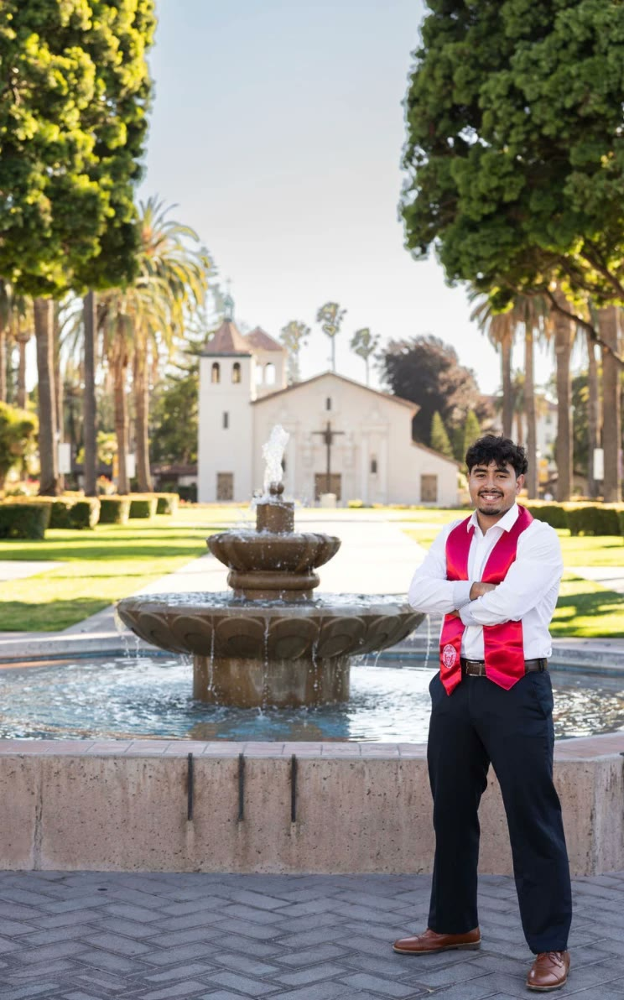
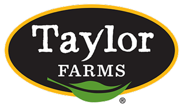

# About

Hi, my name is Ysidro Magana and I’m a **Mechanical Engineer** who minoring in **Electrical Engineering** with a strong background and interest in control systems, robotics and overall mechatronics projects. I’m driven by curiosity and always have a competative and eager mindset to challenge myself. Throughout college, I took every opportunity to grow, from hands-on experience in Formula SAE, to completing internships every summer, to working on leading research projects. All experiences that have helped me refine my technical skills and deepen my passion for engineering.

Outside of academics, I’m highly involved in leadership and community and futbol. I proudly served as Co-President of SHPE (Society of Hispanic Professional Engineers) at Santa Clara University, where I work to uplift and support underrepresented students in STEM. Through SHPE, I’ve built a strong network, helped lead impactful initiatives, and developed my abilities as a communicator and team builder. Through this work I was recognized and given the community service and leadership award from the Mechancial Engineering Department. 

I approach every challenge with dedication and discipline. I’m optimistic by nature, but I also stay grounded in reality, always trying to learn, adapt, and improve.

I'm currently an **Engineering Technician at Tesla**, running and maintaining tests for the Camera Integration team. Before that, I interned at Santa Clara's Robotic Systems Lab, Medtronic, and Taylor Farms, working across autonomous marine vehicles, medical-device manufacturing, and industrial automation.

## Experience

###  Engineering Technician — Tesla

Fremont, CA · Jun 2026 – Present

Running and maintaining tests for Tesla's Camera Integration team.
- Built test fixtures from aluminum extrusion.
- Maintain and improve wiper durability test booths for new wiper designs.

###  Robotic Systems Lab Intern — Santa Clara University

Santa Clara, CA · Jun 2025 – Sep 2025

Developed and deployed autonomous systems for land, air, sea, and space missions.
- Created a PID velocity controller that limits an AUV's descent speed to support its sensor data-acquisition system.
- Prototyped an autonomous underwater sampler holding 0.5 L at 50 m depth for marine research.
- Solved a slipping U-bolt problem by designing an SLS 3D-printed clamp fixture to securely handle a vertical profiler.

###  Advanced Manufacturing Intern — Medtronic

Minneapolis, MN · Jun 2024 – Sep 2024

Supported process optimization and validation for early-stage pharmaceutical medical products.
- Ran a Design of Experiments study in JMP on a sealing process, assessing 8 input variables against 2 outputs to find the best seal procedure.
- Reduced process lead time by **60%** by introducing a stir-plate system that eliminated a non-value-added drug-mixing step.
- Automated a sensor-triggered inspection system, using wiring signal names to make wafers easier to identify on the line.
- Designed and 3D-printed a SolidWorks fixture to protect drug-coated antimicrobial sutures in transit, extending shelf life.

###  Automation Technician Intern — Taylor Farms

Salinas, CA · Jun 2023 – Sep 2023

Maintained the automated systems of North America's largest producer of fresh foods.
- Maintained and troubleshot mechanical, electrical, and programmable systems on production robots, including preventive maintenance and component repair.
- Gained hands-on experience with circuits, PLCs, VFDs, relays, pneumatics, motors, and interconnected systems.

## Education

**Santa Clara University** — B.S. Mechanical Engineering, Minor in Electrical Engineering · Sep 2022 – Jun 2026
 Emphasis: Mechatronics, Control Systems, Advanced Manufacturing

## Skills

- **Design & analysis:** SolidWorks, Fusion 360, Ansys, MATLAB, Simulink, Minitab, JMP
- **Programming & controls:** Arduino (C++), Python, ROS, Verilog, LabVIEW, PID control
- **Manufacturing:** SLS 3D printing (certified), fixture design, Design of Experiments
- **Languages:** English, Spanish (fluent)

## Leadership

- **SHPE (Society of Hispanic Professional Engineers)** — President (Jan 2025 – Mar 2026), Treasurer (Sep 2023 – Jan 2025)
- **School of Engineering Hiring Committee** — One of two student representatives on the committee hiring the School of Engineering's Assistant Dean (2025)
- **Summer Engineering Seminar Mentor** — Mentored 60 high school sophomores and juniors interested in engineering (Summer 2025)

## Contact

The best way to reach me is through [LinkedIn](https://www.linkedin.com/in/ysidro-magana).

